<h1 align="center">MyPortal</h1>

<p align="center">
  <strong>A self-hosted customer portal and service-desk platform for managed service providers.</strong><br />
  Tickets, assets, remote monitoring, Microsoft 365, compliance, billing and automation for every customer company, in one place.
</p>

<p align="center">
  <a href="LICENSE"></a>
  
  
  
  
</p>

<p align="center">
  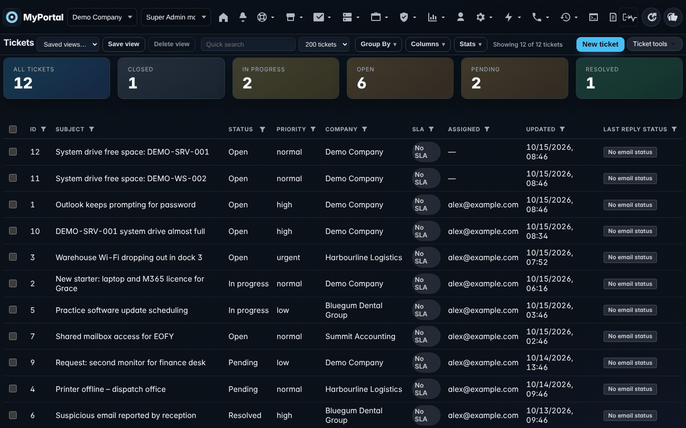
</p>

> [!NOTE]
> MyPortal is largely "vibe coded" and built first for my own internal use. You are welcome to run it and open
> issues, and I'll look at them when I have time. Pull requests are not being accepted at the moment. Many features
> work but have limited testing.

---

## Contents

- [Overview](#overview)
- [Feature tour](#feature-tour)
  - [Service desk](#service-desk)
  - [Remote monitoring and management](#remote-monitoring-and-management)
  - [Sales, shop and billing](#sales-shop-and-billing)
  - [Microsoft 365](#microsoft-365)
  - [Assets, network and staff](#assets-network-and-staff)
  - [Security and compliance](#security-and-compliance)
  - [Automation, AI and administration](#automation-ai-and-administration)
- [Integrations](#integrations)
- [Architecture](#architecture)
- [Installation](#installation)
- [Development](#development)
- [Documentation](#documentation)
- [License](#license)

## Overview

MyPortal gives an MSP and its customers a shared workspace. Technicians and super admins switch between customer
companies from the company switcher in the menu. Customer users see only their own company, limited by the roles and
permissions you give them.

- **Multi-company by design.** Company switching, reusable roles, per-company permissions, a "view as role"
  preview, and impersonation for support.
- **Remote management built in.** The MyPortal RMM agent runs scripts and checks and collects inventory on Windows,
  macOS and Linux devices. On Windows it also handles patching and event log collection.
- **Secure by default.** TOTP two-factor enrolment is mandatory for every account. Passkeys (WebAuthn), CSRF
  protection, rate limiting, session management, an encrypted credential vault, and a full audit trail are built in.
- **Modular.** Each area of the app is a hot-reloadable *feature pack*. Integrations are switched on as *modules*,
  and you can add *plugins* without forking.
- **Operable.** Blue/green production installs, one-click upgrades from the portal, a Docker deployment script,
  Redis-backed multi-worker scaling, and a built-in scheduler.

The menu runs across the top of the page by default. Each user can move it to a left sidebar under
**My Profile → Menu position**.

There are no default credentials. On first visit you are sent to registration, and the first account created becomes
the super administrator.

## Feature tour

> Screenshots were taken from installs loaded with MyPortal's built-in demo data, plus sample tickets and RMM
> devices. The newer screenshots show the default top menu; the older ones show the optional left menu.

### Service desk

| | |
|---|---|
| 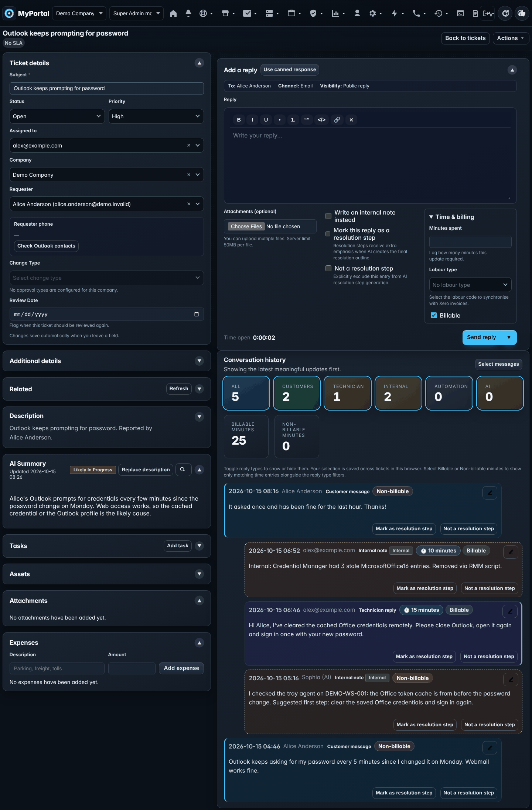 | 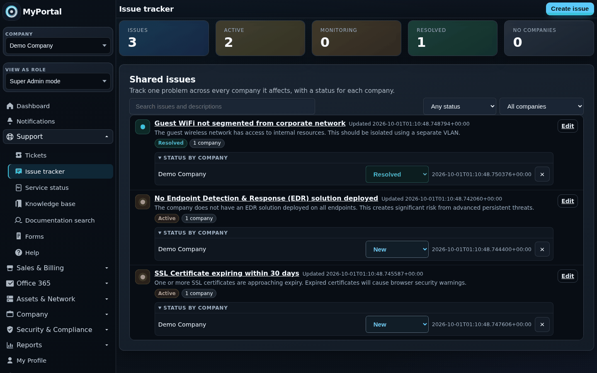 |
| **Ticket detail:** a rich-text reply editor, internal notes, billable time and labour types, resolution steps, AI summaries, tasks, linked assets, attachments, and expenses. Conversation filters split customer, technician, internal, automation and AI replies, with billable and non-billable minutes. | **Issue tracker:** follow one problem across many companies, with a separate status for each company. |

- **Tickets.** Saved views, grouping, configurable columns, status summary cards, watchers, split and merge,
  scheduled ticket creation, SLAs and business hours, email tracking (opens, deliveries, bounces), and replies by
  email over IMAP. Automation and RMM check actions are recorded in the conversation history, internal and AI notes
  stay hidden from customers, and a task completes when its linked ticket closes.
- **Custom forms.** Build request forms from 18 field types, including signatures, star ratings, matrix grids, file
  uploads, audio recordings, and photo or video capture on mobile. Each submission becomes a ticket. Limit a form to
  chosen users, or share it publicly with an expiring magic link.
- **Client onboarding.** Send a new client a single-use magic link to a public onboarding form with your own custom
  questions and invitation email. Their company is created pending your approval, with a ticket in the New Client
  status.
- **Knowledge base.** Articles with permission scopes, conditional content, review dates, AI tags, and natural
  language search. Search runs across both documentation and the knowledge base.
- **Service status, help pages,** customer **chat** (including a [Matrix](docs/wiki/integrations/Matrix%20Chat.md)
  bridge), and an in-app **feedback** button that opens a follow-up ticket.
- **Calls and voice.** Click-to-call, call recordings with transcription, and booking calls through Cal.com.

| | |
|---|---|
| 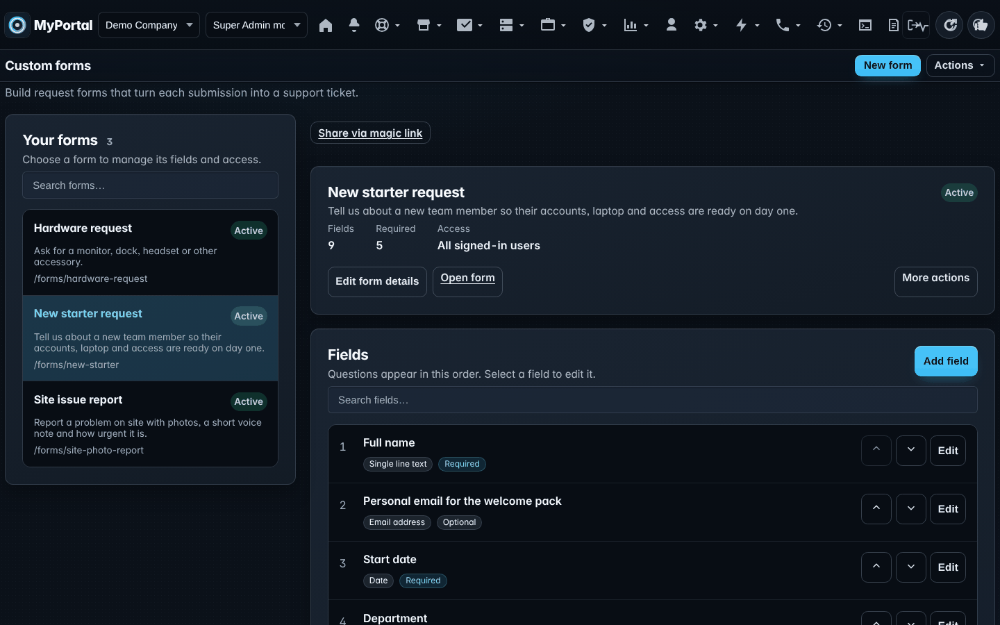 | 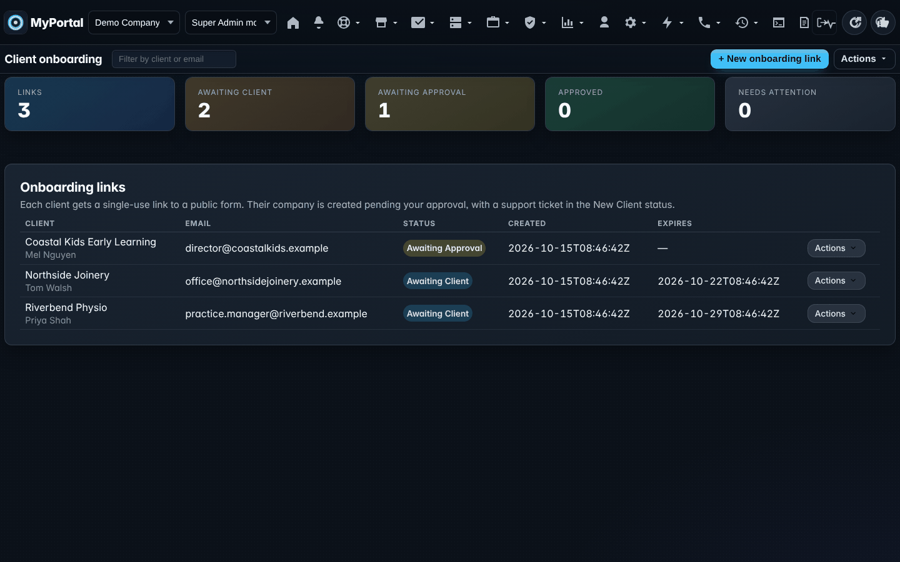 |
| **Custom forms:** a form builder with field ordering, required fields, access control, and magic-link sharing. | **Client onboarding:** track each link from sent to awaiting approval, then approve, decline, regenerate, or revoke it. |

<p align="center">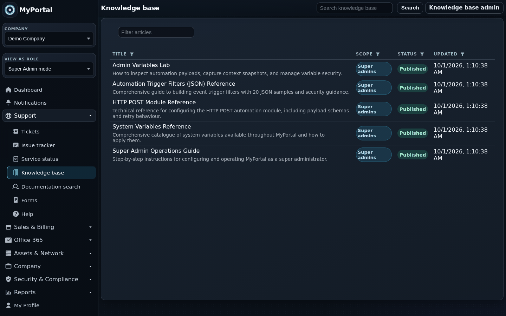</p>

### Remote monitoring and management

The MyPortal RMM agent is a separate service from the tray app. On Windows and macOS the tray app installs it: push it
to one device from the Assets page, or turn on automatic roll-out for a whole company. On Linux, install it by hand.
Each asset shows its agent's status, version and install history, and has a one-click repair.

| | |
|---|---|
| 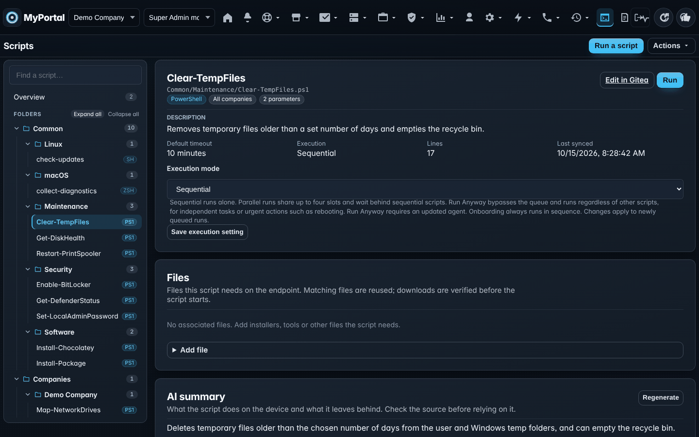 | 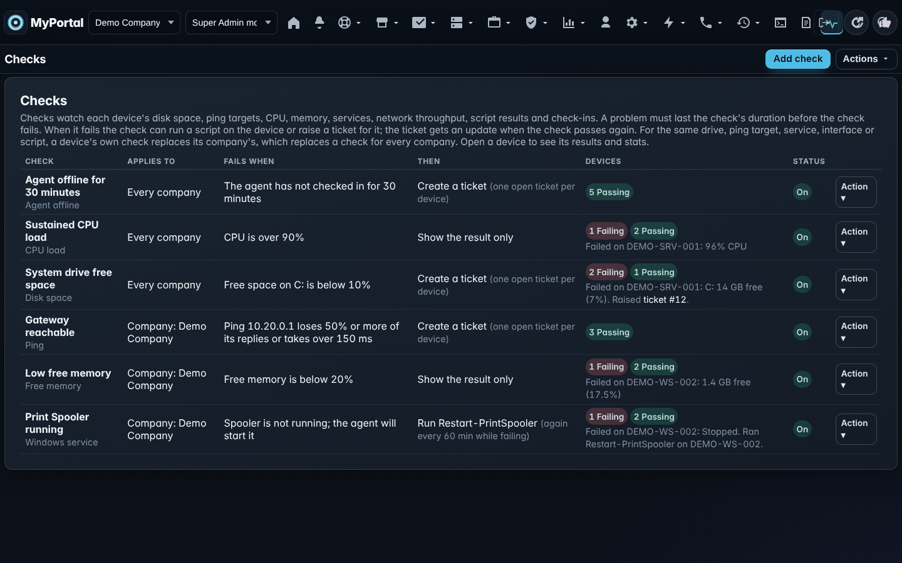 |
| **Scripts:** a PowerShell, Bash and Zsh library kept in Gitea, with Common and per-company folders, parameters detected from each script, AI summaries, and live output. | **Checks:** disk, ping, CPU, memory, Windows service, network throughput, file or folder, process, script result, and agent offline checks that run a script, schedule one, or raise a ticket. |

- **Scripts.** Run a script on one device or many, then retry or cancel it. Attach files that are downloaded and
  verified before the script starts. Each script runs sequentially, in parallel with others, or straight away
  ("Run Anyway") for urgent tasks such as a reboot. Schedules run scripts on a cron, and onboarding scripts run when
  the agent is first installed on a device. Technicians sign in to the bundled Gitea with their MyPortal account.
- **Targeting.** Checks, schedules, patch policies and event log rules can target devices with AND/OR rules on the
  operating system, installed software, tags, custom fields, and more.
- **Event logs.** Windows event logs are collected into a separate database. Event log rules can raise a ticket or
  run or schedule a script when an entry matches.
- **Inventory and machine stats.** Hardware and software inventory with application version history, temperature
  sensors, and CPU, memory, disk, network and ping graphs kept for 90 days.
- **Patch management.** Windows Update policies (update categories, deferral, active hours, and reboot behaviour) and
  Chocolatey application policies, using a Chocolatey package catalogue and per-company package sources.
- **Remote control.** Connect with [RustDesk or MeshCentral](docs/wiki/administration/Remote%20Control.md), switched on
  for each session by an activation script that also installs a missing RustDesk client.
- **Findings.** Every six hours MyPortal looks across every company's RMM data for event spikes, security events,
  software changes, performance outliers and failing checks. An LLM can add insights that link them.

| | |
|---|---|
| 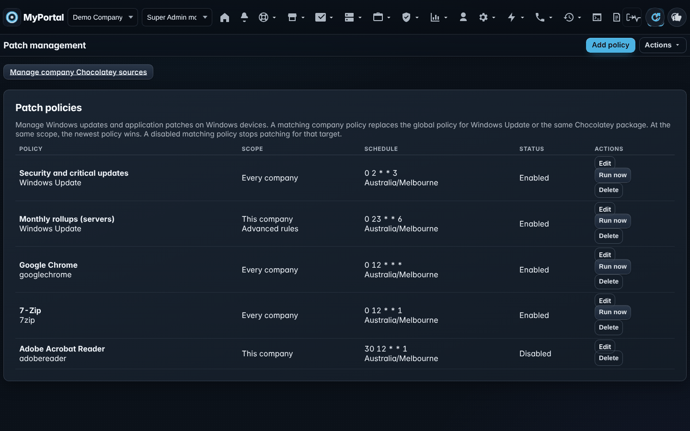 | 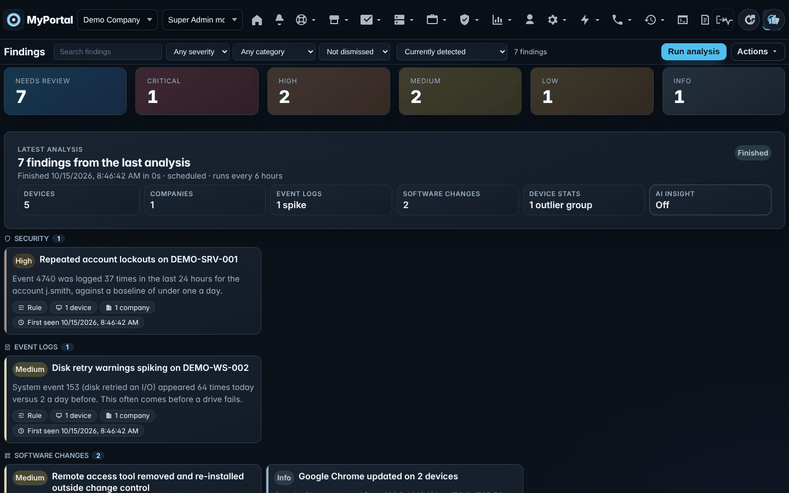 |
| **Patch management:** global and per-company Windows Update and Chocolatey policies, each with its own schedule and device rules. | **Findings:** severity-ranked items to acknowledge or dismiss, with the evidence behind each one. |
| 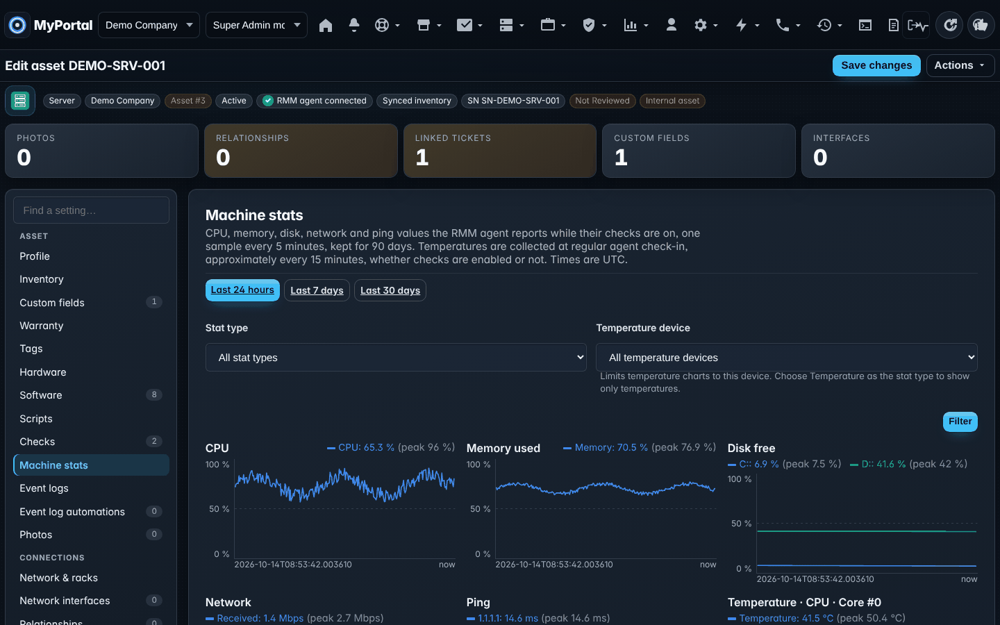 | 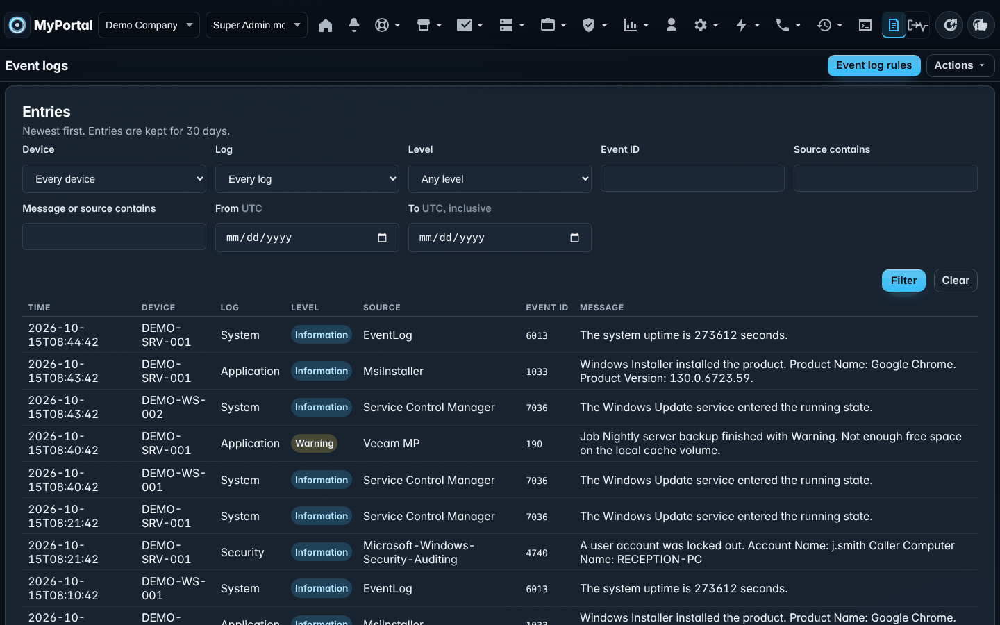 |
| **Machine stats:** per-device performance and temperature history on the redesigned asset page. | **Event logs:** search every collected entry by device, log, level, event ID and message. |

### Sales, shop and billing

| | |
|---|---|
| 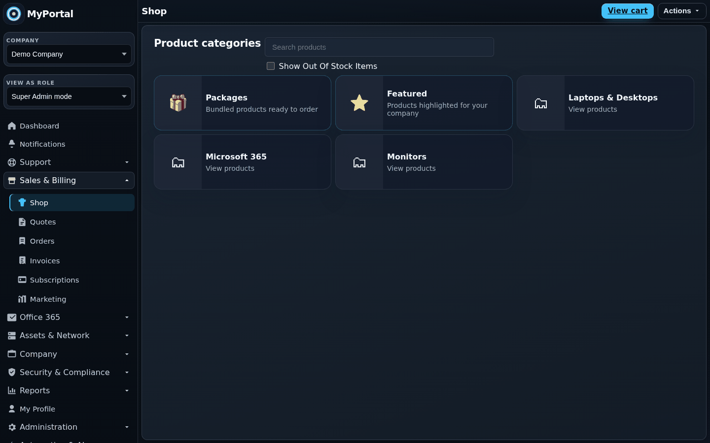 | 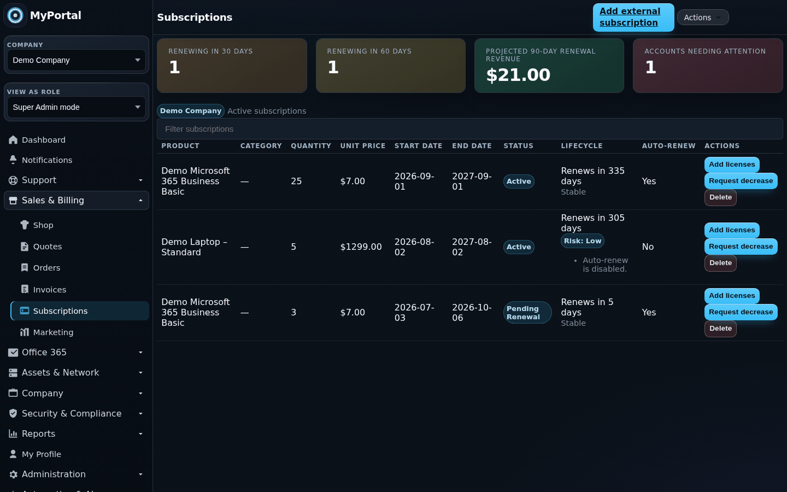 |
| **Shop:** nested categories, packages, featured products, VIP and standard pricing, upsell and cross-sell, stock by region, and vendor feed imports. | **Subscriptions:** renewal forecasting, co-terming, licence increase and decrease requests, and auto-renew controls. |

- Cart, **quotes**, and **orders** with shipping status notifications.
- **Invoices**, with approval workflow and [Xero](docs/wiki/integrations/Xero%20Integration.md) sync of billable
  ticket time, labour rates, and automatic invoice emails to customers.
- **Marketing pages and email campaigns**, with lead capture.

<p align="center">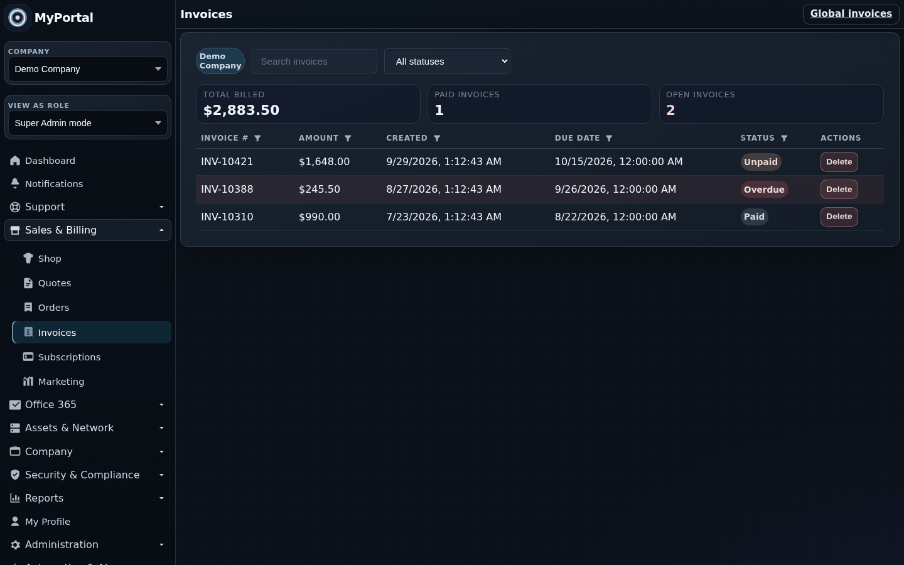</p>

### Microsoft 365

| | |
|---|---|
| 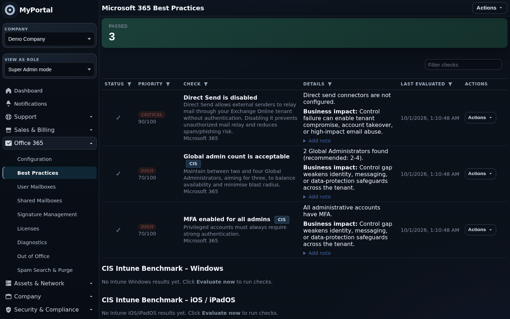 | 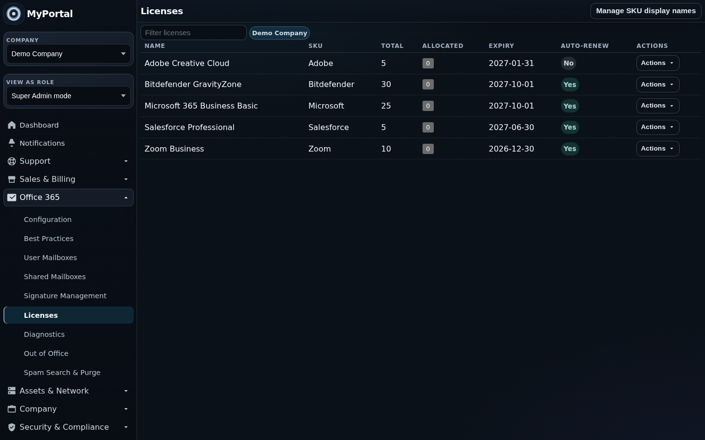 |
| **Best practices:** tenant checks scored against CIS-style benchmarks, with business-impact notes and remediation. | **Licences:** per-SKU totals, allocation, expiry, and auto-renew status. |

- Guided tenant connection through an enterprise app (PKCE), with connection diagnostics. User and shared mailbox
  reporting, Secure Score, out-of-office, spam search and purge, and user-reported emails from Defender.
- **Email signatures** for new Outlook and classic Outlook, with primary and additional signatures targeted by
  staff details such as department, and import from an Outlook signature ZIP.
- **Staff onboarding and offboarding** with admin approval. This covers account provisioning, mailbox forwarding and
  delegation, and OneDrive export on offboarding. Technicians can submit a request on a staff member's behalf.

### Assets, network and staff

| | |
|---|---|
| 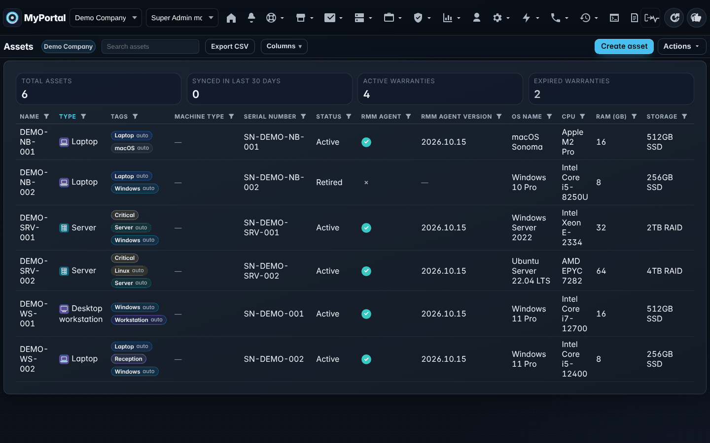 | 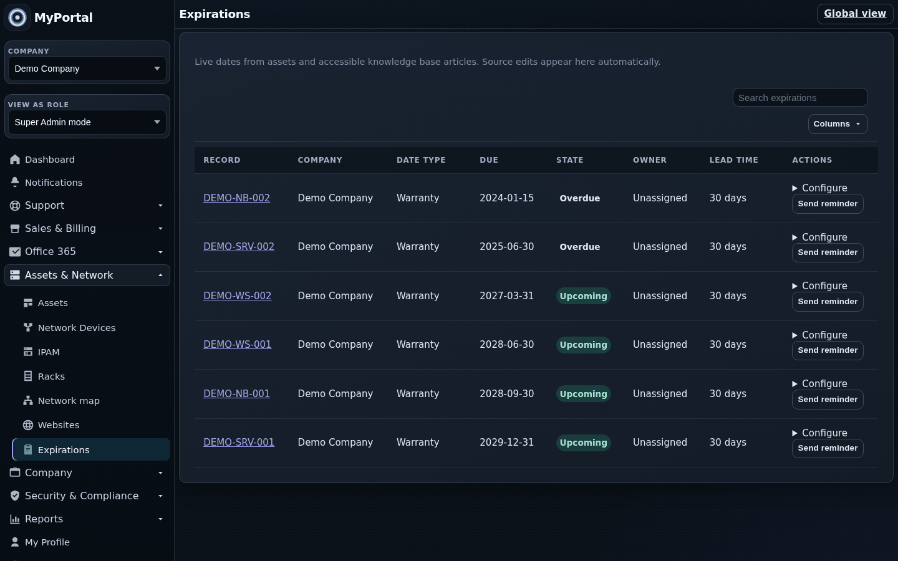 |
| **Assets:** synced from RMM tools or the MyPortal RMM agent, or added by hand, with tags, RMM agent status and version, custom fields, photos, warranty tracking, and CSV export. | **Expirations:** one view of upcoming warranty and knowledge-base expiry dates, with reminders. |

- **Asset detail:** profile, inventory, custom fields (including multi-line text), warranty, tags, hardware,
  software, scripts, checks, machine stats and event logs in one page. Warranty dates can be looked up from
  [Dell, HP and Lenovo](docs/wiki/integrations/Warranty%20Lookup.md).
- **Tags** on assets and companies, alongside automatic tags such as operating system and device type. Scripts,
  checks and automations use them to pick their devices.
- **Network:** network device discovery through subnet scanners, IPAM, rack elevations with an item image library,
  an interactive network map with PDF export, and website availability and certificate monitoring.
- **Staff workspace:** a directory with Microsoft 365 sign-in data, custom fields, and onboarding workflows.
  Alongside it are **processes** (tracked runbooks) and **shared credentials** with secure one-time sharing.

<p align="center">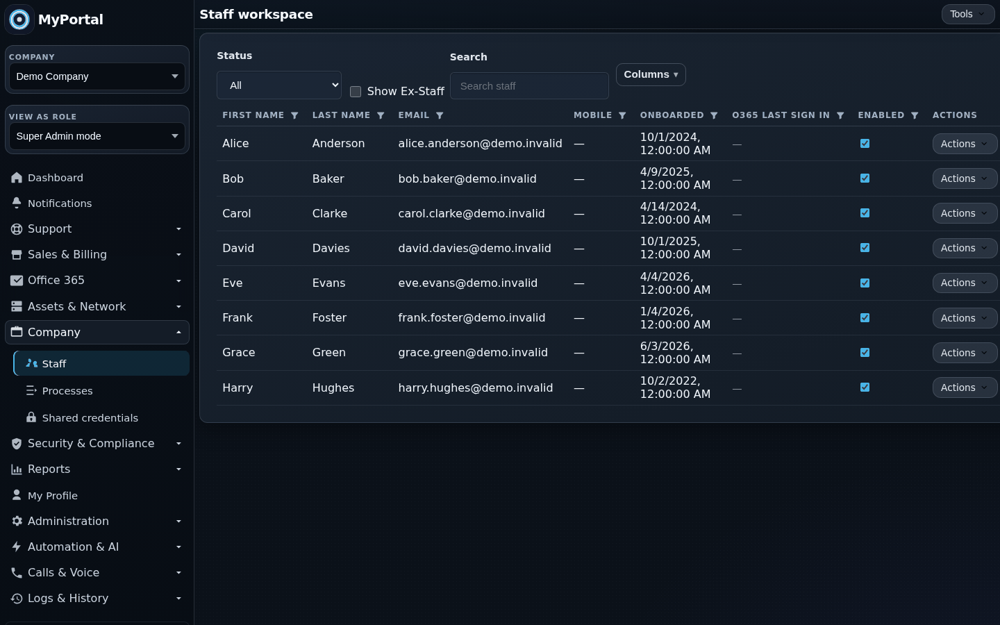</p>

### Security and compliance

| | |
|---|---|
| 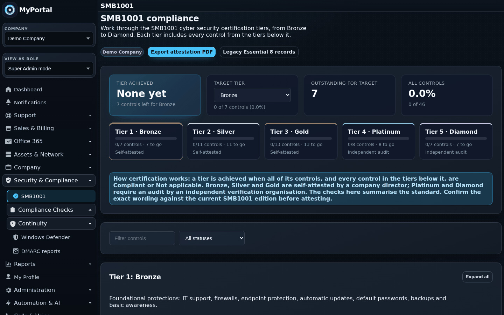 | 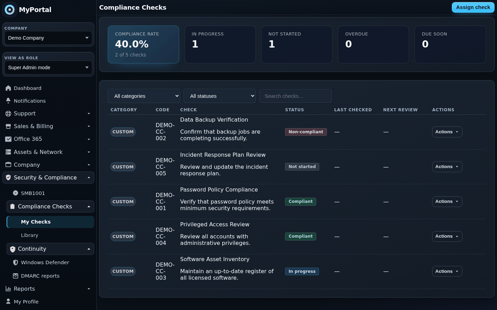 |
| **SMB1001:** tiered certification tracking from Bronze to Diamond, with attestation PDF export and engagement letters. | **Compliance checks:** an assignable library of recurring checks, with status, evidence, and review dates. |

- **Essential Eight** maturity records.
- **Business continuity planning (BCP):** plans, a readiness dashboard, business impact analysis, and an
  assessment library.
- **Windows Defender** health and detections through the tray agent, **DMARC** aggregate reporting, and backup job
  history and daily summaries.
- **Privacy and legal:** a Privacy Policy, Acceptable Use Policy and Terms that users must accept when they change,
  a per-user opt-out from AI processing, an account anonymisation workflow, and a blocklist of email domains that
  cannot be used for companies.
- **Reports:** a company overview PDF, saved reports, and reporting dashboards.

<p align="center">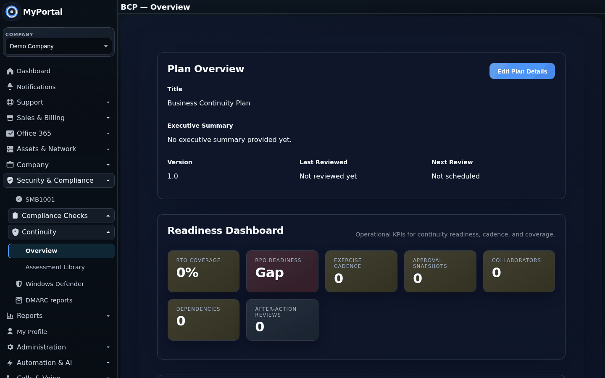</p>

<p align="center">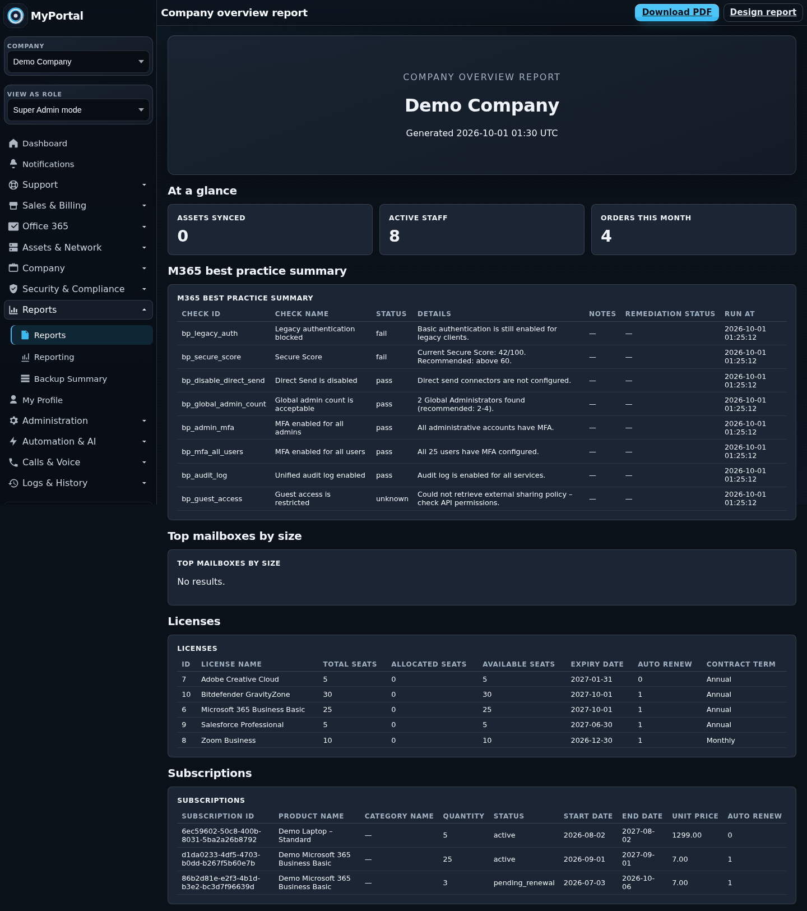</p>
<p align="center"><em>Company overview report: a customer-ready summary of staff, orders, Microsoft 365 best practices,
licences, subscriptions and compliance, with PDF download and a report designer.</em></p>

### Automation, AI and administration

| | |
|---|---|
| 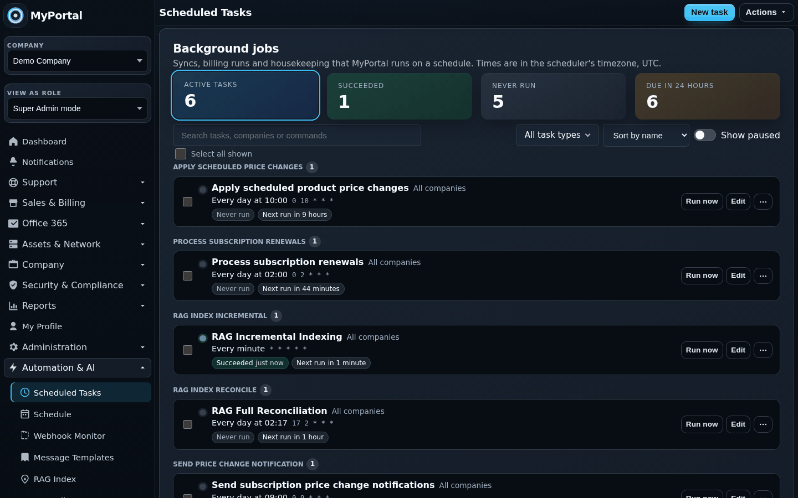 | 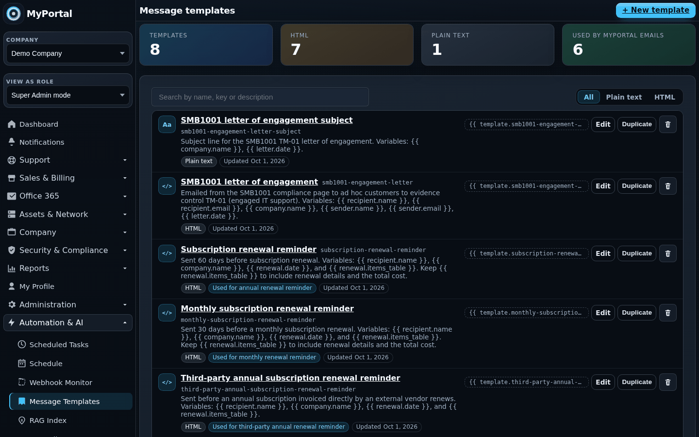 |
| **Scheduled tasks:** background jobs with cron schedules, run history, and a calendar view to spot gaps. | **Message templates:** reusable HTML and plain-text templates with variables, used by notifications and automations. |

- **Automations:** scheduled and event-driven workflows, webhook monitoring with retries, and a variable
  system covering tickets, companies, and staff.
- **AI:** [Ollama](https://ollama.com)-powered ticket summaries, tags, and resolution steps. Also a RAG index over
  tickets and the knowledge base, AI quality evaluation, and an
  [MCP server](docs/wiki/integrations/MCP%20Integration.md) for ChatGPT and other MCP clients. The AI ticket
  troubleshooter works in stages: it finds related articles, suggests steps, then analyses the device's stored event
  logs and log files, and posts its progress as internal notes.
- **Sophia:** the AI support assistant, chat bot and ticket troubleshooter share the name **Sophia**. Set
  `AI_AGENT_NAME` in `.env` to choose another name (blank values use Sophia), then restart the application. Existing
  portal chat history and AI-authored ticket notes show the configured name when they load.
- **Administration:** companies, users, roles, sessions, impersonation, approvals, API keys, modules, feature packs,
  tags, tray app configuration, system updates, a change log, and an audit trail. Also:
  - **LLM usage:** requests and tokens for each MyPortal function and model.
  - **.env checker:** super admins can check the server's settings and format a `.env` file in the browser.
  - **Tray deployment URLs:** per-company download links that build Windows EXE and MSI installers. Tray apps
    update themselves from MyPortal.

| | |
|---|---|
| 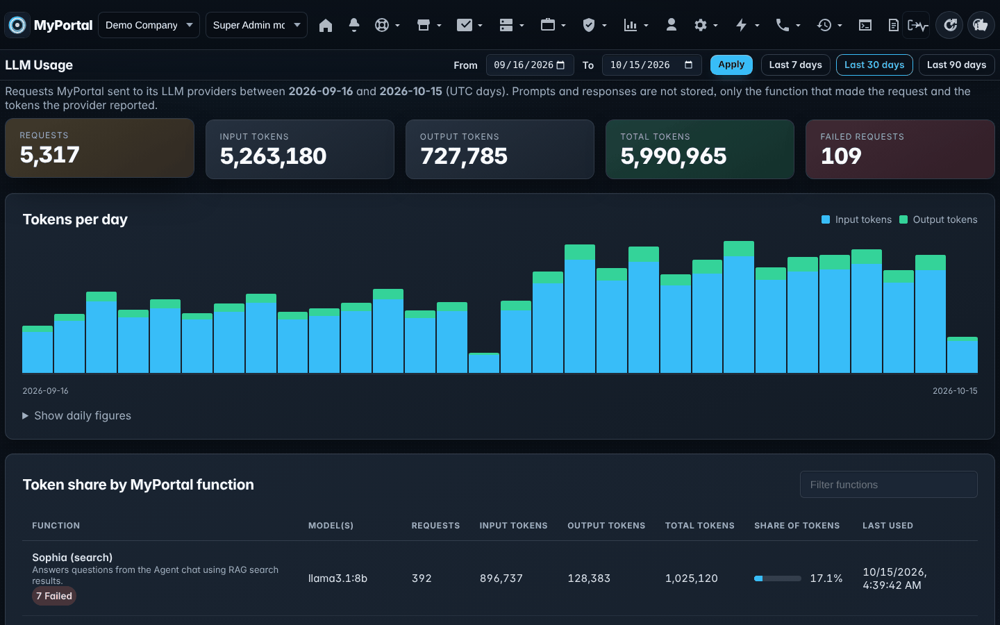 | 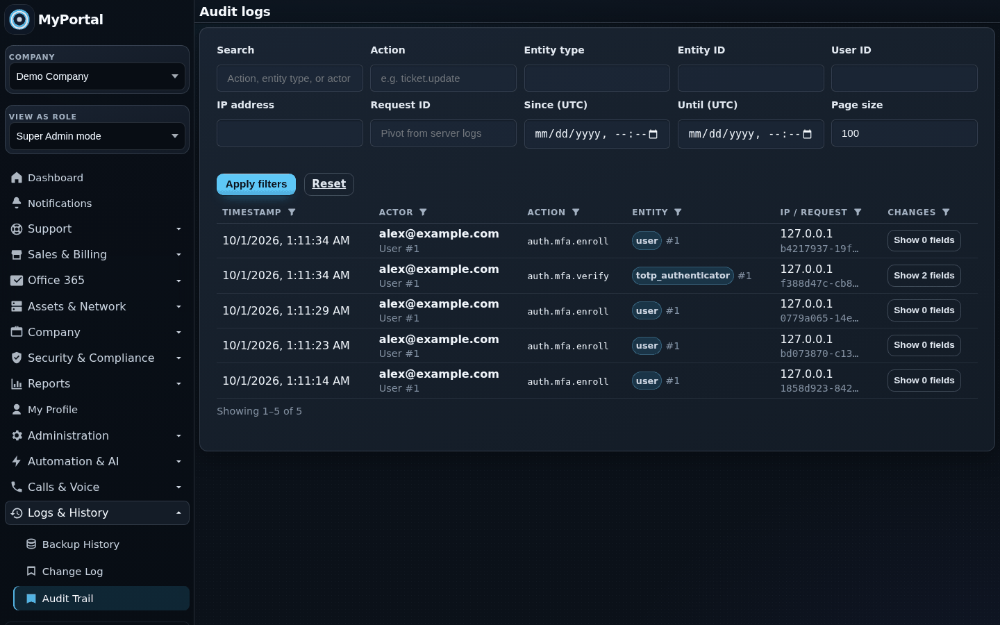 |
| **LLM usage:** daily token totals, failed requests, and each function's share of tokens. | **Audit trail:** every change, with who made it and from where. |

## Integrations

| Area | Integrations |
|---|---|
| RMM and PSA | MyPortal RMM agent, Tactical RMM, Syncro (ticket and company import), Hudu, Huntress |
| Scripts, patching and remote control | Gitea (script library), Chocolatey, RustDesk, MeshCentral |
| Accounting and time | Xero (OAuth2), Solidtime |
| Email | IMAP mailboxes and filters, SMTP and SMTP relay, SMTP2Go (delivery tracking), Microsoft 365 mail |
| Monitoring | Uptime Kuma, Windows Defender (via the tray agent), DMARC reports |
| Warranty | Dell, HP and Lenovo warranty lookup |
| Messaging and notifications | ntfy, Matrix chat, SMS gateway and inbound SMS, Trello |
| AI | Ollama, ChatGPT and MCP clients |
| Other | Cal.com, Password Pusher, generic webhooks, and an HTTP integration for external tools |

Modules are enabled and configured under **Administration → Modules**.

## Architecture

| Layer | Technology |
|---|---|
| Web and API | Python 3.10+, FastAPI, Uvicorn, Jinja2 templates; OpenAPI docs at `/docs` |
| Data | MariaDB 10.10+ through async drivers, with file-driven SQL migrations in [`migrations/`](migrations). Optional separate databases hold RMM event logs and machine stats |
| Background work | APScheduler with cron expressions; optional Redis for multi-worker coordination |
| Documents | WeasyPrint (PDF), python-docx |
| Script library | Gitea, run locally by the installers and served at `/gitea` |
| Tray agent | Go service and UI for Windows and macOS, plus an Electron chat shell ([`tray/`](tray)) |
| RMM agent | Go service for Windows, macOS and Linux ([`rmm/`](rmm)) |

```
app/
├── api/routes/     REST API endpoints
├── features/       Hot-reloadable feature packs (tickets, rmm, shop, m365_admin, compliance, …)
├── services/       Business logic and integration clients
├── repositories/   Database access
├── templates/      Jinja2 views
└── static/         CSS, JavaScript and images
plugins/            Optional plugins (examples: hello_world, custom_dashboard_widget)
rmm/                MyPortal RMM agent
tray/               Cross-platform tray application
deploy/, docker/    nginx, systemd, fail2ban and container deployment assets
```

## Installation

### Production (Ubuntu 24.04 / Debian 12)

The installer sets up nginx on port 80, MariaDB, local Redis, a local Gitea for the RMM script library, and immutable
blue/green releases. It works on bare metal, a VM, or an LXC container.

```bash
sudo git clone https://github.com/bradhawkins85/MyPortal /opt/myportal/control
sudo /opt/myportal/control/scripts/install_production.sh

# Later updates: use Administration → System Updates in the portal, or
sudo myportal-upgrade
```

See [Setup and Installation](docs/wiki/getting-started/Setup%20and%20Installation.md) and
[Zero Downtime Upgrades](docs/wiki/getting-started/Zero%20Downtime%20Upgrades.md).

### Docker

One script installs Docker if it's missing, then deploys MyPortal from GitHub releases (and later upgrades it). You
don't need to clone the repository.

```bash
curl -fsSLO https://github.com/bradhawkins85/MyPortal/releases/latest/download/myportal-docker.sh
sudo bash myportal-docker.sh install
```

See [Running MyPortal with Docker](docs/wiki/getting-started/Docker.md).

### Development server

```bash
sudo scripts/install_development.sh   # editable install, isolated database, optional service on port 8000
```

## Development

Manual setup needs Python 3.10+ and MariaDB 10.10 or newer.

```bash
python -m venv .venv && source .venv/bin/activate
pip install -e ".[dev]"
cp .env.example .env            # set DB_*, SESSION_SECRET, TOTP_ENCRYPTION_KEY, …
python manage.py migrate --target-release development
python -m uvicorn app.main:app --reload
```

- Portal UI: <http://localhost:8000>. The first visit opens registration for the super admin.
- API docs: <http://localhost:8000/docs>
- Tests: `pytest`
- Redis is optional locally and recommended for production. See [Redis](docs/wiki/getting-started/Redis.md).
- RMM event logs and machine stats need their own databases. Set `EVENT_LOG_DB_*` and `STATS_DB_*` in `.env`.

A **Demo Company** with sample staff, assets, licences, subscriptions, compliance checks, and issues is seeded
automatically. It's useful for exploring the UI, and it's what the screenshots above are based on.

## Documentation

| Topic | Where to start |
|---|---|
| Getting started | [Overview](docs/wiki/getting-started/Overview.md) · [Configuration](docs/wiki/getting-started/Configuration.md) · [Tray App](docs/wiki/getting-started/Tray%20App.md) · [Tray Build Server](docs/wiki/getting-started/Tray%20Build%20Server.md) · [Onboarding Wizard](docs/wiki/getting-started/Onboarding%20Wizard.md) |
| RMM | [Scripts](docs/wiki/administration/RMM%20Scripts.md) · [Checks](docs/wiki/administration/RMM%20Checks.md) · [Event Logs](docs/wiki/administration/RMM%20Event%20Logs.md) · [Inventory](docs/wiki/administration/RMM%20Inventory.md) · [Patch Management](docs/wiki/administration/RMM%20Patch%20Management.md) · [Findings](docs/wiki/administration/RMM%20Findings.md) · [Remote Control](docs/wiki/administration/Remote%20Control.md) |
| Administration | [Message Templates](docs/wiki/administration/Message%20Templates.md) · [Network Map](docs/wiki/administration/Network%20Map.md) · [Company Memberships](docs/wiki/administration/Company%20Memberships.md) · [API Keys](docs/wiki/administration/API%20Keys.md) · [Client Onboarding](docs/wiki/administration/Client%20Onboarding.md) · [Tags](docs/wiki/administration/Tags.md) · [LLM Usage](docs/wiki/administration/LLM%20Usage.md) · [Legal Policies](docs/wiki/administration/Legal%20Policies.md) |
| Tickets | [IMAP Setup](docs/wiki/tickets/IMAP%20Setup.md) · [Email Reply Handling](docs/wiki/tickets/Email%20Reply%20Handling.md) · [Split and Merge](docs/wiki/tickets/Ticket%20Split%20and%20Merge.md) · [Tickets API](docs/wiki/tickets/Tickets%20API.md) · [Custom Forms API](docs/wiki/api-reference/Custom%20Forms%20API.md) |
| Compliance | [SMB1001](docs/wiki/compliance/SMB1001.md) · [Essential 8](docs/wiki/compliance/Essential%208%20Requirements.md) · [Security Overview](docs/wiki/compliance/Security%20Overview.md) |
| Integrations | [Xero](docs/wiki/integrations/Xero%20Integration.md) · [Uptime Kuma](docs/wiki/integrations/Uptime%20Kuma.md) · [MCP](docs/wiki/integrations/MCP%20Integration.md) · [Microsoft 365 app setup](docs/wiki/m365/PKCE%20App%20Setup.md) · [Warranty Lookup](docs/wiki/integrations/Warranty%20Lookup.md) |
| Developers | [Feature Packs](docs/wiki/developer/Feature%20Packs.md) · [Plugins](docs/wiki/developer/Plugins.md) · [UI Layout Standards](docs/wiki/developer/UI%20Layout%20Standards.md) · [Design Guidelines](docs/wiki/developer/Design%20Guidelines.md) |
| Security | [Passkeys](docs/passkeys.md) · [Fail2ban](docs/wiki/getting-started/Fail2ban%20Setup.md) |

## License

MyPortal is licensed under the [GNU Affero General Public License v3.0](LICENSE).

See [LICENSE](LICENSE) for the full terms.
